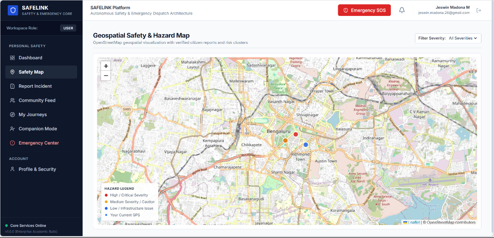
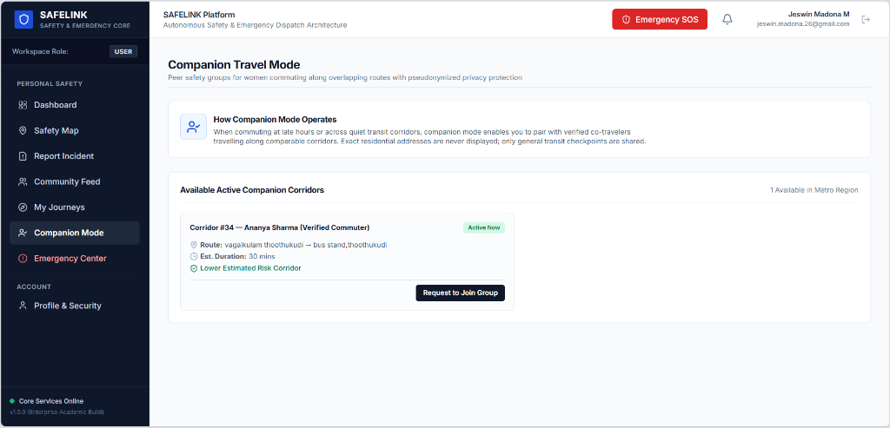
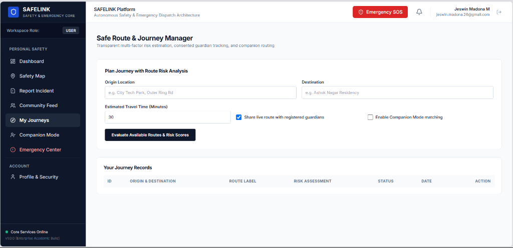
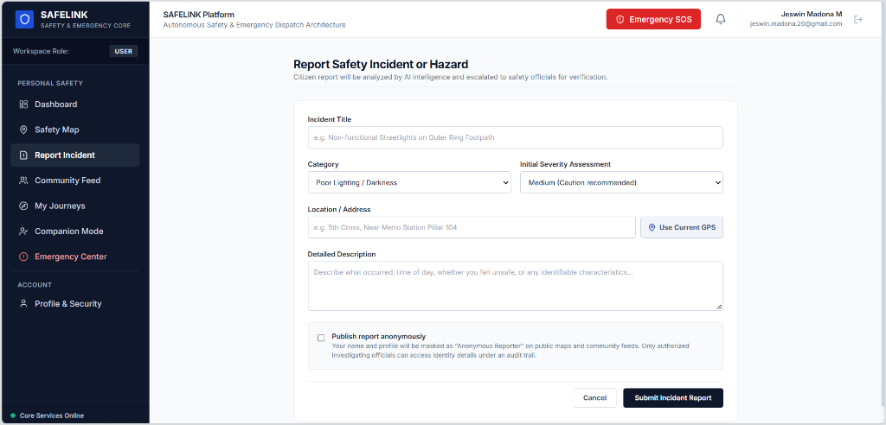
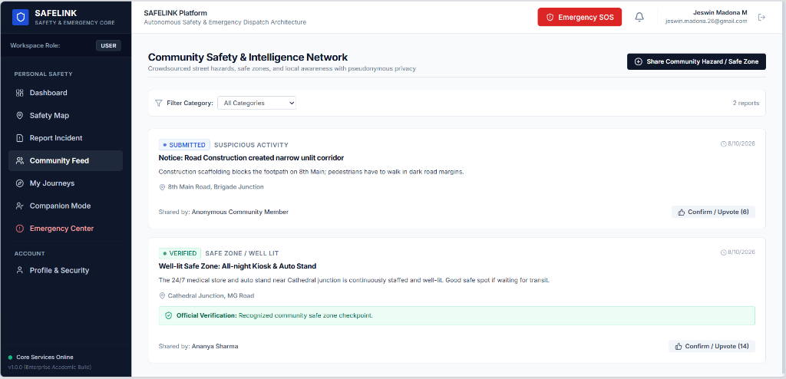

# SafeLink — Enterprise Safety & Emergency Response Platform


A production-ready **Java Fullstack** emergency response and personal safety management system. SafeLink combines a robust **Spring Boot 3** REST backend with a modern **React 18 (TypeScript)** responsive dashboard, role-based access control (RBAC), geospatial tracking, and an asynchronous AI microservice for incident classification and risk analysis.

---

## 📌 Table of Contents
- [Overview](#-overview)
- [Architecture & Tech Stack](#-architecture--tech-stack)
- [Application Screenshots](#-application-screenshots)
- [Core Features](#-core-features)
- [Fullstack Engineering Highlights](#-fullstack-engineering-highlights)
- [Database Design](#-database-design)
- [REST API Reference](#-rest-api-reference)
- [Project Directory Structure](#-project-directory-structure)
- [Getting Started](#-getting-started)
  - [Prerequisites](#prerequisites)
  - [Option 1: Quick Run (Spring Boot + Embedded H2)](#option-1-quick-run-local-development-mode)
  - [Option 2: Docker Compose (Full Stack with PostgreSQL)](#option-2-docker-compose-production-stack)
- [Demo Credentials](#-demo-credentials)
- [CI/CD & DevOps](#-cicd--devops)

---

## 📖 Overview

SafeLink is engineered to handle mission-critical safety workflows with high reliability, clear audit trails, and strict data privacy:
- **Immediate Distress Dispatch**: Trigger and manage SOS alerts through an end-to-end lifecycle state machine (`ACTIVE` ➔ `ACKNOWLEDGED` ➔ `RESPONDING` ➔ `RESOLVED`).
- **Consensual Travel Monitoring**: Stream live GPS telemetry only during active emergency events or consented travel journeys.
- **Incident Intelligence**: Collect crowdsourced hazard reports and run automated severity triage via an NLP microservice.
- **Multi-Role Operations**: Tailored user interfaces for Citizens, Family Guardians, Dispatch Officials/Police, and Administrators.

---

## 🏛 Architecture & Tech Stack

```
   ┌──────────────────────────────────────────────────────────────┐
   │               React 18 + TypeScript Client                   │
   │      (Vite • Tailwind CSS • Leaflet Maps • Lucide Icons)     │
   └──────────────────────────────┬───────────────────────────────┘
                                  │ HTTPS / REST (JWT Bearer)
                                  ▼
   ┌──────────────────────────────────────────────────────────────┐
   │             Spring Boot 3.3.5 Backend Service                │
   │  ┌────────────────────────────────────────────────────────┐  │
   │  │ Security Layer (Spring Security 6 • JJWT • RBAC Filter)│  │
   │  ├────────────────────────────────────────────────────────┤  │
   │  │ REST Controllers (DTO Validation • Global Exception)   │  │
   │  ├────────────────────────────────────────────────────────┤  │
   │  │ Service Layer (Emergency Engine • Journey • Audit)     │  │
   │  ├────────────────────────────────────────────────────────┤  │
   │  │ Persistence Layer (Spring Data JPA • Hibernate ORM)    │  │
   │  └────────────────────────────────────────────────────────┘  │
   └───────────────┬──────────────────────────────┬───────────────┘
                   │ JDBC                         │ HTTP (RestTemplate)
                   ▼                              ▼
   ┌──────────────────────────────┐   ┌──────────────────────────────┐
   │   PostgreSQL 16 / H2 DB      │   │    Python FastAPI Engine     │
   │ (Normalized Relational Schema│   │ (Sentence-Transformers / NLP │
   │  & SHA-256 Audit Records)    │   │  Semantic Similarity & Triage│
   └──────────────────────────────┘   └──────────────────────────────┘
```

### Technology Matrix

| Layer | Technologies |
| :--- | :--- |
| **Backend Framework** | **Java 21**, **Spring Boot 3.3.5**, Spring Web, Spring Data JPA, Hibernate ORM |
| **Security & Auth** | **Spring Security 6**, JJWT 0.12.6, BCrypt password hashing, Stateless JWT filters |
| **Frontend UI** | **React 18**, **TypeScript**, Vite 6, Tailwind CSS, React Router v6, Axios |
| **Geospatial & Mapping** | **Leaflet**, OpenStreetMap |
| **Database** | **PostgreSQL 16** (production/docker), **H2 Database** (zero-config local dev) |
| **AI Microservice** | Python 3.10, FastAPI, Sentence-Transformers (`all-MiniLM-L6-v2`), PyTorch |
| **DevOps & Containers** | Docker, Docker Compose, Multi-stage builds, Jenkins CI/CD pipeline |

---

## 📸 Application Screenshots

### 1. Geospatial Safety & Hazard Map
Interactive Leaflet and OpenStreetMap integration showing live user position, verified street hazards, and color-coded risk clusters (`Critical`, `Medium/Caution`, `Infrastructure`).


### 2. Companion Travel Mode
Peer safety groups enabling commuters along overlapping transit routes to pair with pseudonymized privacy protection and real-time corridor monitoring.


### 3. Safe Route & Journey Manager
Multi-factor route risk assessment, consented live tracking with authorized guardians, and estimated transit duration evaluation.


### 4. Report Safety Incident or Hazard
Citizen hazard reporting portal with GPS coordinates auto-capture, category classification, and automated escalation to the AI triage engine.


### 5. Community Safety & Intelligence Network
Crowdsourced community hazard and safe zone alerts with peer confirmation counts and official dispatcher verifications.


---

## ✨ Core Features

### 1. Multi-Tier Role-Based Access Control (RBAC)
- **`ROLE_USER`**: Citizen portal to trigger one-click SOS distress, start monitored journeys, report hazards, and browse verified community posts.
- **`ROLE_GUARDIAN`**: Real-time tracking of linked wards during active trips and instantaneous push notifications upon SOS trigger.
- **`ROLE_OFFICIAL`**: Police / Dispatch command center with live incident queues, map markers, status updates, and verification controls.
- **`ROLE_ADMIN`**: Governance, user permissions, department assignments, and audit inspection.

### 2. SOS Emergency Response Lifecycle
- Real-time emergency state management:
  $$\text{ACTIVE} \longrightarrow \text{ACKNOWLEDGED} \longrightarrow \text{RESPONDING} \longrightarrow \text{RESOLVED / CANCELLED}$$
- Captures GPS coordinates, battery level, accuracy, and audio/text metadata.

### 3. Safe Journey Companion Mode
- Share trip progress with designated guardians with automated arrival confirmation and deviation alerts.
- Dynamic route risk evaluation based on historic incidents and lighting/crowd parameters.

### 4. Crowdsourced Hazard Reporting & AI Triage
- Citizen hazard reports (unlit streets, harassment spots, road blocks).
- Fast classification via the Python FastAPI microservice to assess severity and cluster similar incidents.

### 5. Tamper-Evident Audit Logging
- Every high-privilege action (emergency triage, status change, incident resolution) is recorded with a **SHA-256 cryptographic hash** ensuring compliance and non-repudiation.

---

## 🚀 Fullstack Engineering Highlights

- **Clean Layered Architecture**: Strict separation of concerns across `Controller` ➔ `Service` ➔ `Repository` layers.
- **Stateless JWT Authentication**: Custom `OncePerRequestFilter` extracting claims from `Authorization: Bearer <token>` headers with role-based method security.
- **Enterprise Error Handling**: Centralized `@RestControllerAdvice` mapping validation errors (`MethodArgumentNotValidException`) and domain exceptions to standardized `ApiResponse<T>` envelopes.
- **DTO Pattern & Bean Validation**: Strict payload validation using Jakarta Bean Validation (`@NotBlank`, `@NotNull`, `@Size`) ensuring defensive boundary checking.
- **Resilient Microservice Client**: Configured `RestTemplate` with connection/read timeouts and graceful fallback logic when communicating with the AI service.
- **Dual-Database Portability**: Seamlessly switches between in-memory/file **H2** (zero installation for dev) and containerized **PostgreSQL 16** via Spring profiles (`dev` vs. `postgres`).
- **Responsive React SPA**: Built with TypeScript interfaces matching backend DTOs, Axios interceptors for automatic JWT injection, and route guards.

---

## 🗄 Database Design

Key JPA entities managed with Hibernate:

| Entity | Description | Key Relationships |
| :--- | :--- | :--- |
| `User` | User profiles, credentials, role, department | `1:N` Emergencies, `1:N` Journeys |
| `GuardianRelationship` | Links a citizen to an authorized guardian | Many-to-One with `User` |
| `Emergency` | Active distress events and lifecycle statuses | Associated with `User` |
| `Journey` | Monitored travel sessions with start/destination coordinates | Associated with `User` & `Guardian` |
| `Incident` | Verified or unverified hazard reports with severity ratings | Associated with reporting `User` |
| `CommunityPost` | Pseudonymous community safety discussion feed | Comments and upvote counts |
| `AuditLog` | Immutable record of official actions with SHA-256 hash digests | Department and actor references |

---

## 📡 REST API Reference

All protected endpoints require an `Authorization: Bearer <token>` header.

### Authentication (`/api/auth`)
| Method | Endpoint | Description | Access |
| :--- | :--- | :--- | :--- |
| `POST` | `/api/auth/register` | Register citizen or guardian account | Public |
| `POST` | `/api/auth/login` | Authenticate user and obtain JWT token | Public |
| `GET` | `/api/auth/me` | Fetch authenticated user profile | Authenticated |

### Emergencies & SOS (`/api/emergencies`)
| Method | Endpoint | Description | Access |
| :--- | :--- | :--- | :--- |
| `POST` | `/api/emergencies/trigger` | Broadcast new SOS alert with GPS telemetry | `USER` |
| `GET` | `/api/emergencies/active` | Get current active emergencies for user | `USER`, `GUARDIAN` |
| `GET` | `/api/emergencies/queue` | Live dispatch queue for emergency triage | `OFFICIAL`, `ADMIN` |
| `PUT` | `/api/emergencies/{id}/status` | Update lifecycle state (`RESPONDING`, `RESOLVED`) | `OFFICIAL` |

### Journeys (`/api/journeys`)
| Method | Endpoint | Description | Access |
| :--- | :--- | :--- | :--- |
| `POST` | `/api/journeys/start` | Initialize a travel companion session | `USER` |
| `PUT` | `/api/journeys/{id}/location`| Update live location during travel | `USER` |
| `PUT` | `/api/journeys/{id}/complete`| Safely end journey upon arrival | `USER` |
| `GET` | `/api/journeys/active` | Retrieve active journeys of linked wards | `GUARDIAN` |

### Incidents & Safety Map (`/api/incidents`)
| Method | Endpoint | Description | Access |
| :--- | :--- | :--- | :--- |
| `POST` | `/api/incidents` | Submit a safety hazard report | Authenticated |
| `GET` | `/api/incidents/map` | Get geo-located incidents for map view | Authenticated |
| `PUT` | `/api/incidents/{id}/verify` | Approve/verify incident report | `OFFICIAL` |

### Audit Logs & AI (`/api/audit`, `/api/ai`)
| Method | Endpoint | Description | Access |
| :--- | :--- | :--- | :--- |
| `GET` | `/api/audit/logs` | Fetch immutable audit trail records | `OFFICIAL`, `ADMIN` |
| `POST` | `/api/ai/analyze` | Request incident NLP severity triage | Authenticated |

---

## 📂 Project Directory Structure

```
safelink/
├── backend/                              # Spring Boot 3 Java Service
│   ├── src/main/java/com/safelink/
│   │   ├── config/                       # DataInitializer (seeds demo accounts)
│   │   ├── controller/                   # REST API Controllers
│   │   ├── dto/                          # Request / Response DTOs
│   │   ├── entity/                       # JPA Entities (User, Emergency, Journey, etc.)
│   │   ├── exception/                    # GlobalExceptionHandler & Custom Exceptions
│   │   ├── repository/                   # Spring Data JPA Repositories
│   │   ├── security/                     # SecurityConfig, JWT Filter & Token Provider
│   │   └── service/                      # Core Business Logic & AiServiceClient
│   ├── src/main/resources/
│   │   ├── application.yml               # Base configuration
│   │   ├── application-dev.yml           # H2 in-memory profile
│   │   └── application-postgres.yml      # PostgreSQL production profile
│   ├── pom.xml                           # Maven dependencies
│   └── Dockerfile                        # Multi-stage JDK build
│
├── frontend/                             # React 18 + TypeScript Client
│   ├── src/
│   │   ├── components/                   # Navigation, status badges, alert widgets
│   │   ├── context/                      # AuthContext (JWT management & state)
│   │   ├── pages/                        # Role-specific dashboards & portals
│   │   ├── services/                     # Axios client & API integrations
│   │   └── types/                        # TypeScript domain interfaces
│   ├── package.json
│   ├── vite.config.ts                    # Vite bundler & reverse proxy
│   └── Dockerfile                        # Multi-stage Nginx build
│
├── ai-service/                           # Python FastAPI Microservice
│   ├── app/                              # NLP Incident Classifier & Similarity Engine
│   ├── requirements.txt
│   └── Dockerfile
│
├── database/                             # Database initialization scripts
│   └── init.sql
├── screenshots/                          # Platform UI walkthrough screenshots
├── docker-compose.yml                    # Multi-container orchestration
├── Jenkinsfile                           # Automated CI/CD build pipeline
└── README.md
```

---

## ⚡ Getting Started

### Prerequisites
- **Java**: JDK 21+
- **Node.js**: v18+ and `npm`
- *(Optional for full stack container run)*: **Docker** & **Docker Compose**

---

### Option 1: Quick Run (Local Development Mode)

This mode runs the backend using the embedded **H2 Database** (no PostgreSQL setup required).

#### 1. Start the Backend (Spring Boot)
```bash
# Windows (PowerShell / CMD)
cd backend
.\mvnw.cmd spring-boot:run

# Linux / macOS
cd backend
./mvnw spring-boot:run
```
- Server starts at: `http://localhost:8080`
- H2 Web Console: `http://localhost:8080/h2-console` *(JDBC URL: `jdbc:h2:file:./data/safelinkdb` | User: `sa` | Password: empty)*

#### 2. Start the Frontend (React + Vite)
In a new terminal window:
```bash
cd frontend
npm install
npm run dev
```
- Client runs at: `http://localhost:5173`

#### 3. (Optional) Start the AI Microservice
In a new terminal window:
```bash
cd ai-service
pip install -r requirements.txt
python -m uvicorn app.main:app --host 0.0.0.0 --port 8000 --reload
```
- Microservice runs at: `http://localhost:8000` *(Interactive Swagger docs at `http://localhost:8000/docs`)*

---

### Option 2: Docker Compose (Production Stack)

To run the complete production environment (PostgreSQL 16, Spring Boot, React, and Python AI Service) in isolated containers:

```bash
docker compose up --build
```

**Services map:**
- **Frontend**: `http://localhost:3000`
- **Backend API**: `http://localhost:8080`
- **AI Microservice**: `http://localhost:8000`
- **PostgreSQL**: `localhost:5432` *(Database: `safelink`, User: `postgres`, Password: `postgrespassword`)*

---

## 🔑 Demo Credentials

The backend automatically seeds test accounts on first run:

| Role | Email | Password | Persona & Scope |
| :--- | :--- | :--- | :--- |
| **Citizen (User)** | `user@safelink.org` | `User@123` | Ananya Sharma (SOS & Journey Access) |
| **Guardian** | `guardian@safelink.org` | `Guardian@123` | Rajesh Sharma (Ward Tracking) |
| **Official (Police)** | `official@safelink.org` | `Official@123` | Insp. Vikram Patil (Dispatch Queue & Audit) |
| **Admin** | `admin@safelink.org` | `Admin@123` | System Administrator (Full Access) |

> 💡 *The login page also provides one-click quick-fill buttons for instant evaluation.*

---

## 🔄 CI/CD & DevOps

- **Containerization**: Optimized multi-stage Dockerfiles for both Spring Boot (Eclipse Temurin JDK 21) and React (Vite build served by Nginx).
- **Automation (`Jenkinsfile`)**:
  - Stage 1: Checkout repository
  - Stage 2: Maven clean test & compile
  - Stage 3: Frontend TypeScript verification & build
  - Stage 4: Docker image packaging
- **Configuration Management**: Profiles configured via Spring environment variables (`application-dev.yml` and `application-postgres.yml`).
